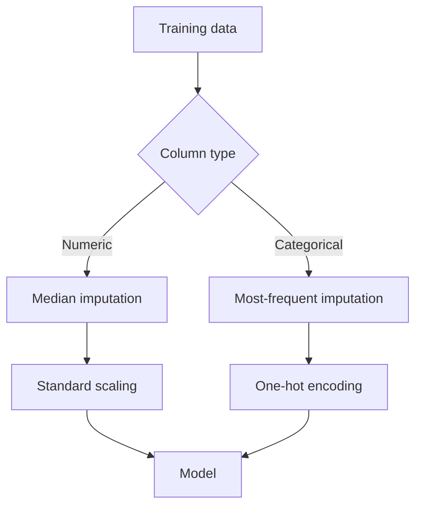

# Student Performance Predictor

> **A simple, honest machine-learning project that predicts final student grade `G3` without using `G1` or `G2`.**


## Project in one sentence

This project studies how attendance, study habits, family background, school
support, and other recorded characteristics relate to students' final grades,
then builds a model that predicts `G3` without using the earlier grade columns.

## Why this project matters

The original UCI dataset contains `G1` and `G2`, which are earlier grades.
They are very strong clues about `G3`, but the assignment specifically says
not to use them. This project follows that rule so the model focuses on
information that could be available before the final grade is known.

## Project flow

```mermaid
flowchart LR
    A[UCI student-mat.csv] --> B[Check data]
    B --> C[Remove duplicates]
    C --> D[Remove G1 and G2]
    D --> E[Create safe predictor features]
    E --> F[Train/test split]
    F --> G[Preprocessing pipeline]
    G --> H[Compare models]
    H --> I[Cross-validation tuning]
    I --> J[Final ensemble]
    J --> K[Evaluation and report]
```



## Dataset

| Item | Value |
|---|---|
| Source | UCI Student Performance Dataset |
| Source link | https://doi.org/10.24432/C5TG7T |
| Course file | `student-mat.csv` |
| Rows | 395 |
| Target | `G3`, final grade from 0 to 20 |
| Removed columns | `G1`, `G2` |
| Missing cells after cleaning | 0 |
| Duplicate rows after cleaning | 0 |

The dataset includes school information, demographics, family education,
study time, failures, support, activities, absences, health, and social
characteristics.

## What is included

```text
student_performance_project/
|
|-- data/
|   |-- raw/student-mat.csv
|   `-- cleaned/student_mat_cleaned.csv
|
|-- outputs/
|   |-- figures/
|   |   |-- actual_vs_predicted.png
|   |   |-- g3_by_failures.png
|   |   |-- g3_by_higher_education_goal.png
|   |   |-- g3_by_school_support.png
|   |   |-- g3_by_studytime.png
|   |   |-- g3_distribution.png
|   |   |-- g3_vs_absences.png
|   |   |-- numeric_correlations.png
|   |   `-- residual_distribution.png
|   |-- best_params.json
|   |-- cv_model_comparison.csv
|   |-- data_validation.json
|   |-- feature_importance.csv
|   |-- final_model.joblib
|   |-- model_metrics.csv
|   |-- report.md
|   `-- test_predictions.csv
|
|-- requirements.txt
|-- student_performance_project.py
`-- README.md
```

## How to run it

Open PowerShell inside this folder:

```powershell
py -3.14 -m pip install -r requirements.txt
py -3.14 student_performance_project.py
```

The script can also be run with another Python 3 installation:

```powershell
python -m pip install -r requirements.txt
python student_performance_project.py
```

## Data preparation

The project checks the target range, removes exact duplicate rows, confirms
that the target is present, and removes `G1` and `G2`.

The model uses safe predictor-only features:

| Feature | Meaning |
|---|---|
| `parent_education_avg` | Average of mother and father education levels |
| `alcohol_avg` | Average weekday and weekend alcohol-use score |
| `social_time` | Combined free time and going-out score |
| `support_count` | Count of selected support or activity indicators |
| `absence_log1p` | Log-transformed absence count |

These features do not use any earlier grade.

## Preprocessing



The preprocessing is inside a scikit-learn pipeline. It is fitted on training
data only, which prevents information from the test set leaking into training.

## Models

| Model | Purpose |
|---|---|
| Ridge regression | Simple linear baseline |
| Random Forest | Nonlinear tree-based baseline |
| Gradient Boosting | Nonlinear boosting comparison |
| Histogram Gradient Boosting | Efficient boosting comparison |
| Tuned Random Forest | Hyperparameter-tuned tree model |
| Final ensemble | Average of tuned Random Forest and Histogram Gradient Boosting |

The final model is selected using shuffled five-fold cross-validation on the
training data. The test set is used only for the final evaluation.

## Final results

| Metric | Result |
|---|---:|
| MAE | 3.103974 |
| RMSE | 3.787684 |
| R-squared | 0.300341 |

Regression does not have a normal classification-style accuracy percentage.
The R-squared value means the model explains about **30.03% of the variation**
in final grades on this test split. An average absolute error of about 3.10
grade points is more useful to understand the practical prediction quality.

## Main patterns

The exploratory analysis and permutation importance suggest that failures,
absences, social behavior, school support, age, parent education, and study
time contain useful signals.

These are associations, not proof that one behavior causes a grade change. The
model can help identify students for supportive conversations, but it should
not be used to label, punish, or deny opportunities to students.

## Limitations

- The dataset contains only 395 Math-course observations.
- It comes from two schools in Portugal and may not generalize elsewhere.
- The data is observational, so it cannot prove causation.
- Some fields are self-reported.
- The target is treated as numeric regression even though grades are ordered.
- Removing `G1` and `G2` is required, but it also makes prediction harder.
- A model score can change with a different train/test split.

## Assignment checklist

- [x] Read the UCI data description and variable definitions
- [x] Data preprocessing
- [x] Exploratory data analysis
- [x] Predictive model building
- [x] Model evaluation
- [x] Hyperparameter tuning
- [x] No `G1` or `G2` used as model inputs
- [x] Cleaned dataset included
- [x] Report included
- [ ] Add actual group-member names and contributions to `outputs/report.md`

## 21-day plan

| Days | Work |
|---:|---|
| 1-2 | Read the UCI documentation and define the target |
| 3-5 | Validate and clean the dataset |
| 6-9 | Complete EDA and plots |
| 10-13 | Build baseline models |
| 14-16 | Tune models with cross-validation |
| 17-18 | Evaluate and interpret results |
| 19-20 | Finish report and contributions |
| 21 | Re-run, verify, and submit |

## Source and educational use

Dataset source: Cortez, Paulo. (2014). Student Performance. UCI Machine
Learning Repository. https://doi.org/10.24432/C5TG7T

This repository is for an educational data-science project. It should not be
used to make high-stakes decisions about real students.
